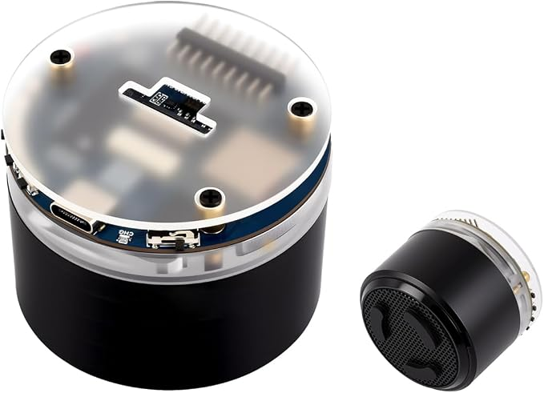
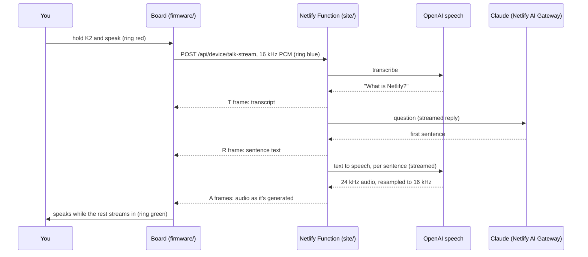

# smart-esp32



**Device:** [SMKTelec ESP32-S3 AI Smart Speaker Development Board (Amazon B0GWQDCHK8)](https://www.amazon.com/dp/B0GWQDCHK8),
a rebrand of the [Waveshare ESP32-S3-AUDIO-Board](https://www.waveshare.com/wiki/ESP32-S3-AUDIO-Board).

**TL;DR:** a desk voice assistant built from a $25 ESP32-S3 speaker board and a Netlify site.
Hold K2, ask a question, let go. The board uploads your voice to a Netlify Function, which
transcribes it, asks Claude for a short answer, turns the answer into speech, and streams the
audio back so the board starts talking about 5 seconds after you let go.

The repo has two halves:

| | What it is | Runs on |
|---|---|---|
| [`firmware/`](#firmware-firmware) | C++ for the ESP32-S3 (PlatformIO, Arduino core 3.x) | the board, over USB |
| [`site/`](#netlify-site-site) | Netlify Functions in TypeScript: the board's backend and AI pipeline | Netlify, deployed from `main` |

## How it works



Measured on this setup: the transcript reaches the board about 2 s after you let go, the first
reply sentence about 1.7 s later, and the speaker starts about 5 s after release. The old
non-streaming route (`/api/device/talk`) waits for the whole answer and is kept for comparison.

## Netlify site (`site/`)

The board has no API keys and no AI code. Everything smart happens in one Netlify Function,
[`site/netlify/functions/device.mts`](site/netlify/functions/device.mts), served at
`https://smart-esp32.netlify.app/api/device/*`.

**Netlify features in use**

- **Functions** as the device backend: modern `export default` handlers with `config.path` routing.
- **Streaming responses**: `talk-stream` returns a `ReadableStream`, so audio leaves Netlify sentence
  by sentence instead of after the full reply is ready.
- **AI Gateway**: Claude is called with the Anthropic SDK and no key in the repo or site settings.
  The gateway injects the credentials at runtime.
- **Environment variables** (secret, functions scope) for the device token and the OpenAI key.
- **Git deploys from `main`** via the root [`netlify.toml`](netlify.toml) (`base = "site"`). An
  `ignore` rule skips the build when a commit only touches firmware.

**Endpoints** (all need `Authorization: Bearer <DEVICE_TOKEN>`; audio is raw PCM, 16 kHz,
16-bit signed little-endian, mono)

| Endpoint | Request | Response |
|---|---|---|
| `GET /api/device/ping` | | `{ ok, deviceId, serverTime, deployId, clientIp, ai }` |
| `POST /api/device/event` | `{ type, key }` | `{ ok, received, led: [r,g,b] }` (button press demo) |
| `POST /api/device/say` | `{ text, voice? }` | spoken audio |
| `POST /api/device/talk` | recorded speech | spoken reply, plus `X-Transcript` / `X-Reply` headers |
| `POST /api/device/talk-stream` | recorded speech | framed stream, see below |

`talk-stream` frames are `[1-byte type][4-byte little-endian length][payload]`:
`T` transcript, `R` reply sentence, `A` audio chunk, `E` error, `Z` end.

**Pipeline pieces** in [`site/lib/`](site/lib)

| File | Does |
|---|---|
| `openai-speech.ts` | speech to text (`gpt-4o-mini-transcribe`) and text to speech (`gpt-4o-mini-tts`), batch and streaming |
| `claude-reply.ts` | the reply: Claude Opus 5.5 at low effort, prompted for 25 words or fewer, streamed one sentence at a time, capped at 2 sentences / 40 words |
| `audio.ts` | WAV wrapping and a windowed-sinc resampler (24 kHz to 16 kHz), batch and streaming |

**Site environment variables**

| Variable | Needed | Notes |
|---|---|---|
| `DEVICE_TOKEN` | yes | must match `DEVICE_TOKEN` in your local `.env` |
| `OPENAI_TTS_API_KEY` | yes | used for both transcription and speech |
| `CLAUDE_MODEL`, `OPENAI_STT_MODEL`, `OPENAI_TTS_MODEL` | no | override the defaults above |

Anthropic credentials come from the AI Gateway, which needs at least one production deploy
before it activates. `GET /api/device/ping` reports `ai.claudeGateway` and `ai.openaiSpeech`.

**Working on the site:** `cd site && npm install && npm run typecheck`. There is no local dev
server in this workflow: push to `main` and test against production, or open a branch and test
its deploy preview.

## Firmware (`firmware/`)

**What it does today**

- Hold-to-talk on K2, with the streaming voice round trip above. Pressing K2 while it's answering
  interrupts the reply and starts listening again.
- K1, K3 and BOOT post an event to Netlify; the ring lights in the color the function returns.
- A serial console for driving and testing everything from a terminal (`make cmd`).
- Wi-Fi, HTTPS with the built-in CA bundle, config stored in flash (NVS).

**Ring colors:** red = listening, blue = thinking, green = speaking.

**Layout**

```
include/board.h   pin map (the single source of truth for pins)
src/main.cpp      setup, button handling
src/voice.*       push-to-talk: record, stream the reply, play it
src/audio.*       I2S at 16 kHz, ES8311 speaker codec, ES7210 mic ADC, tone/record/play
src/net.*         Wi-Fi, NVS config, HTTPS JSON, binary and streaming requests
src/hw.*          I2C, TCA9555 IO expander (amp enable, keys), RGB ring
src/console.*     serial command console
lib/es8311, lib/es7210   codec drivers from Espressif (Apache-2.0), see their READMEs
test/             on-device Unity hardware tests
load_env.py       bakes ../.env into the build
scripts/          devcmd.py (drive the console), wipe.sh (clean slate)
```

**Dev loop** (run from `firmware/`)

```sh
make setup        # .venv with PlatformIO + esptool
make flash        # build + upload over USB
make monitor      # interactive serial console, type `help`
make cmd C=info   # one-shot console commands; exits non-zero on ERR
make listen       # print board output for 30 s (button and talk events)
make test         # on-device hardware tests (run `make flash` afterwards)
make wipe         # clean slate: eFuse check, full erase, verify every byte is blank
```

If upload can't connect: hold BOOT, tap RESET, release BOOT, then `make flash` again.

**Console commands** (`make cmd C="<command>"`, quote multi-word ones: `C="'led 0 40 0' scan"`)

| Command | Does |
|---|---|
| `info`, `scan`, `keys` | chip and Wi-Fi status, I2C scan, button state |
| `led <r> <g> <b>` / `led off` / `led spin` | LED ring |
| `tone [hz] [ms]`, `vol [0-100]` | speaker test, volume |
| `rec [seconds]`, `playback` | record from the mics and print levels, play it back |
| `say <text>` | speak text through Netlify TTS |
| `talk [seconds]` | full voice round trip without pressing a button |
| `ping`, `event <type> [key]`, `get <url>` | API checks |
| `wifi`, `wifi scan`, `config show / set / clear`, `amp on/off`, `reboot` | setup and debugging |

## Hardware

Verified on this unit with esptool and an I2C scan.

| | |
|---|---|
| SoC | ESP32-S3 (QFN56) rev v0.2, dual core 240 MHz, Wi-Fi + BLE 5 (no Bluetooth Classic) |
| Memory | 16 MB flash, 8 MB PSRAM |
| USB | native USB-Serial/JTAG, shows up as `/dev/cu.usbmodem*` (no driver needed) |
| Audio | ES8311 codec + speaker amp (enable on EXIO8), ES7210 mic ADC with 2 mics, speaker module included |
| Buttons | right to left: K1, K2, K3 (on the IO expander), BOOT (GPIO0), RESET (hardware reset, not readable) |
| Other | 7 RGB LEDs (GPIO38, RGB byte order), TCA9555 IO expander, PCF85063 RTC, microSD slot, LCD and camera connectors, Li-ion battery connector with charging |

Pins: [`firmware/include/board.h`](firmware/include/board.h), from Waveshare's demo code plus
checks on this unit.

## Setup from scratch

1. **Secrets:** `cp .env.example .env` and fill in Wi-Fi, `API_BASE` (your site URL) and a random
   `DEVICE_TOKEN`. `.env` is gitignored, and the firmware build reads it through `load_env.py`.
   Values set on the device with `config set` override it.
2. **Netlify:** create a site linked to this repo (the root `netlify.toml` handles build settings),
   then set `DEVICE_TOKEN` and `OPENAI_TTS_API_KEY` on it. Deploy `main` once so the AI Gateway
   activates.
3. **Board:** `cd firmware && make setup && make flash`, then `make cmd C="wifi ping"`.
4. **Talk:** hold K2, ask something, let go.

## Known limits and next steps

- A K2 press during the thinking phase (ring blue) isn't seen yet; it only interrupts once reply
  audio is streaming.
- The board records only the left mic; the right one measured slightly louder.
- Battery level isn't readable: no battery-sense pin has been identified.
- Next: stream the mic audio while you talk (WebSockets / a long-running server) to cut the
  ~2 s upload and transcription wait, and OTA firmware updates hosted on Netlify.
